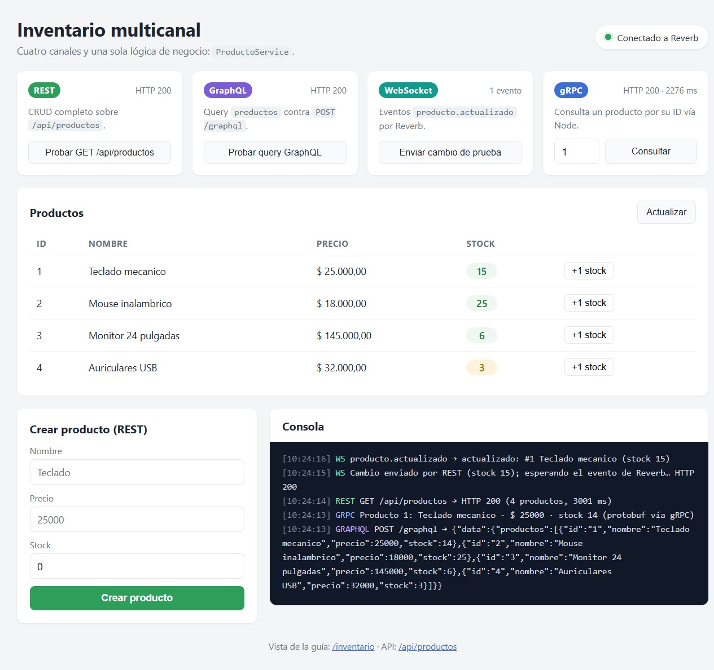
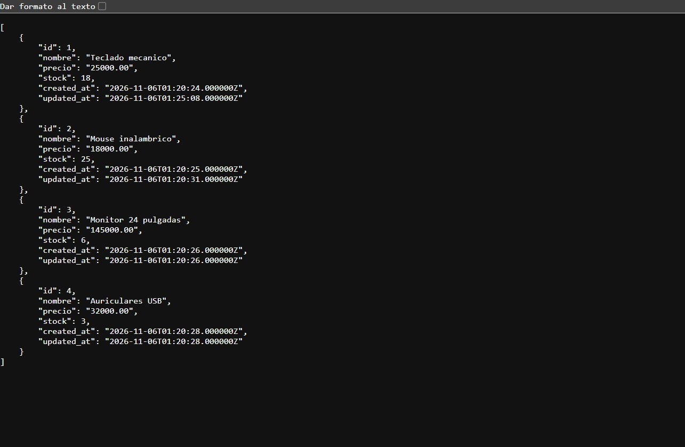
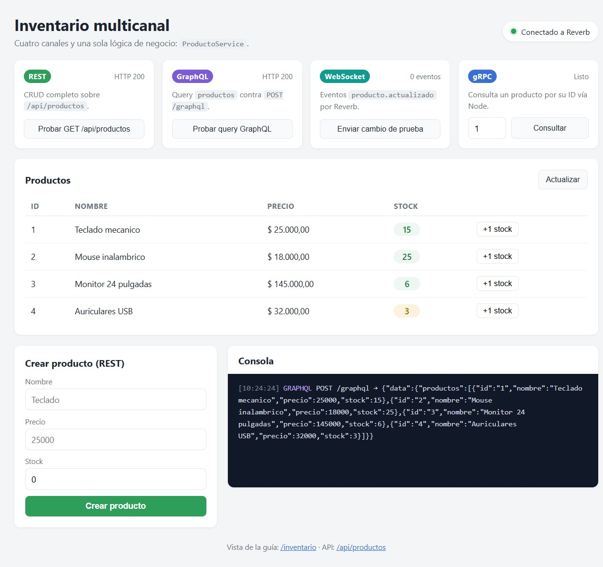
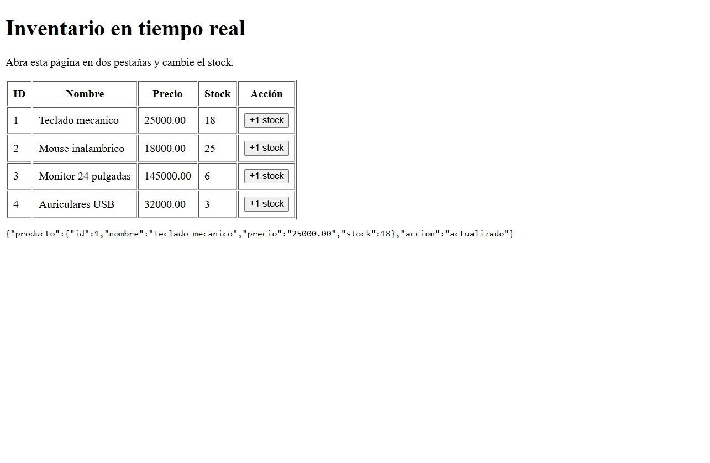

# 🔌 Inventario multicanal — REST · GraphQL · WebSockets · gRPC

Trabajo Práctico — **Programación IV** — UTN FRRe — Cohorte 2026

Aplicación Laravel que administra un inventario de productos y expone **la misma lógica de negocio por cuatro canales distintos**:

| Canal | Entrada | Uso |
|---|---|---|
| **REST** | `/api/productos` | CRUD completo (JSON sobre HTTP). |
| **GraphQL** | `POST /graphql` | Consultas y mutaciones con un solo endpoint. |
| **WebSockets** | Reverb, canal `inventario` | Cambios en vivo para todos los clientes conectados. |
| **gRPC** | `127.0.0.1:50051` | Consulta de productos con contrato Protobuf. |

Además incluye un **panel multicanal** (`/multicanal`) que muestra los productos en tiempo real y permite probar cada canal desde el navegador.

- **Repositorio:** https://github.com/liabarcos/inventario-multicanal

### Contenido

1. [Arquitectura](#-arquitectura)
2. [Entorno utilizado](#️-entorno-utilizado)
3. [Instalación y ejecución](#-instalación-y-ejecución)
4. [API REST](#-api-rest)
5. [GraphQL](#-graphql)
6. [WebSockets con Reverb](#-websockets-con-reverb)
7. [gRPC](#-grpc)
8. [Panel multicanal](#-panel-multicanal)
9. [Capturas](#-capturas)
10. [Tests](#-tests)
11. [Seguridad](#-seguridad)
12. [Solución de problemas](#-solución-de-problemas)

---

## 🧠 Arquitectura

La regla del trabajo es **no duplicar la lógica**: todos los canales llaman al mismo servicio.

```text
REST      ─┐
GraphQL   ─┤──► ProductoService ──► Eloquent (SQLite) ──► evento ProductoActualizado
gRPC      ─┘                                                     │
                                                                 ▼
                                                     Reverb (WebSocket) ──► navegadores
```

- **`ProductoService`** centraliza validaciones, altas, modificaciones y bajas.
- Cada cambio dispara **`ProductoActualizado`**, que se difunde por el canal público `inventario`.
- **gRPC es de solo lectura**: su servidor Node consulta un endpoint interno de Laravel protegido con una clave compartida.

| Componente | Archivo | Responsabilidad |
|---|---|---|
| Modelo | `app/Models/Producto.php` | Tabla `productos` (`nombre`, `precio`, `stock`). |
| Servicio | `app/Services/ProductoService.php` | Lógica única de negocio y emisión del evento. |
| REST | `app/Http/Controllers/Api/ProductoController.php` | Controlador del CRUD. |
| GraphQL | `graphql/schema.graphql` + `app/GraphQL/Mutations/ProductoMutator.php` | Schema y resolvers de Lighthouse. |
| Evento | `app/Events/ProductoActualizado.php` | Broadcast por Reverb. |
| gRPC | `grpc/producto.proto`, `grpc/server.cjs`, `grpc/client.cjs` | Contrato, servidor y cliente Node. |
| Vistas | `resources/views/multicanal.blade.php`, `resources/views/inventario.blade.php` | Panel propio y vista de la guía. |

### Flujo de una actualización

1. Llega una petición por **REST** o **GraphQL**.
2. El controlador o el resolver delega en **`ProductoService`**.
3. El servicio valida y guarda con **Eloquent**.
4. Se dispara **`ProductoActualizado`** con el producto y la acción (`creado` / `actualizado`).
5. La **cola** toma el evento y **Reverb** lo publica en el canal `inventario`.
6. Todos los navegadores suscritos actualizan la tabla sin recargar.

Si el cambio llega por **gRPC**, en realidad es una **lectura**: el servidor Node consulta el endpoint interno protegido y devuelve el producto por Protobuf, sin escribir en la base.

---

## 🖥️ Entorno utilizado

| Componente | Versión |
|---|---|
| Sistema operativo | **Windows 11** (10.0.26300) |
| PHP | 8.3.36 |
| Laravel | 13.40.0 |
| Composer | 2.10.3 |
| Node.js | 24.22.0 |
| npm | 11.19.1 |
| Base de datos | SQLite |
| WebSockets | Laravel Reverb 1.x |
| GraphQL | Lighthouse 6.74 |
| gRPC | `@grpc/grpc-js` + `@grpc/proto-loader` |

> El cliente gRPC de Python que menciona la guía es **opcional**. En este equipo no hay Python instalado, así que se usa el cliente Node incluido (`grpc/client.cjs`), que cumple la misma función.

---

## 🚀 Instalación y ejecución

### 1. Preparar el proyecto

```powershell
git clone https://github.com/liabarcos/inventario-multicanal.git
cd inventario-multicanal
composer install
Copy-Item .env.example .env
php artisan key:generate
php artisan migrate
php artisan db:seed --class=ProductoSeeder   # datos de ejemplo
npm install
```

Si el archivo `database/database.sqlite` no existe:

```powershell
New-Item database/database.sqlite -ItemType File
php artisan migrate
php artisan db:seed --class=ProductoSeeder
```

### 2. Levantar los procesos

Cada canal necesita su proceso. Abrir una terminal por cada uno:

| Terminal | Comando | Puerto |
|---|---|---|
| 1 | `php artisan serve --host=127.0.0.1 --port=8002` | 8002 |
| 2 | `php artisan reverb:start --host=127.0.0.1 --port=8082` | 8082 |
| 3 | `php artisan queue:work` | — |
| 4 | `npm run dev` (o `npm run build`) | 5173 |
| 5 | `cd grpc` y `node server.cjs` | 50051 |

El servidor gRPC necesita la misma clave que Laravel:

```powershell
cd grpc
$env:GRPC_INTERNAL_KEY='clave-local-larga-de-prueba'
node server.cjs
```

### 3. Abrir la aplicación

- Panel multicanal: <http://127.0.0.1:8002/multicanal>
- Vista de la guía: <http://127.0.0.1:8002/inventario>
- API REST: <http://127.0.0.1:8002/api/productos>
- GraphQL: `POST http://127.0.0.1:8002/graphql`

---

## 🔵 API REST

| Método | Ruta | Descripción | Respuesta |
|---|---|---|---|
| GET | `/api/productos` | Lista todos los productos. | `200` |
| POST | `/api/productos` | Crea un producto. | `201` |
| GET | `/api/productos/{id}` | Muestra un producto. | `200` / `404` |
| PATCH | `/api/productos/{id}` | Actualiza campos enviados. | `200` / `404` |
| DELETE | `/api/productos/{id}` | Elimina un producto. | `204` |

La validación fallida responde **422** con el detalle de los campos.

```powershell
curl.exe -i http://127.0.0.1:8002/api/productos

curl.exe -i -X POST http://127.0.0.1:8002/api/productos `
  -H "Accept: application/json" -H "Content-Type: application/json" `
  -d '{\"nombre\": \"Teclado\", \"precio\": 25000, \"stock\": 12}'

curl.exe -i -X PATCH http://127.0.0.1:8002/api/productos/1 `
  -H "Accept: application/json" -H "Content-Type: application/json" `
  -d '{\"stock\": 11}'

curl.exe -i -X DELETE http://127.0.0.1:8002/api/productos/1
```

> Para ver el JSON con sangría durante una demostración: `GET /api/productos?pretty=1`.

---

## 🧭 Decisiones de diseño

| Decisión | Por qué |
|---|---|
| **Un solo `ProductoService`** | Evita que REST, GraphQL y gRPC validen o guarden distinto. Si cambia una regla, cambia una vez. |
| **Evento + cola para el broadcast** | La respuesta HTTP no espera a que se difunda el cambio; el usuario recibe rápido y la cola se encarga del WebSocket. |
| **GraphQL con Lighthouse** | Aprovecha `@all` y `@find` para las lecturas y resolvers propios para las mutaciones, reutilizando el servicio. |
| **gRPC de solo lectura** | Demuestra el canal con un contrato Protobuf sin duplicar la escritura. El servidor Node no toca la base: pasa por el endpoint interno. |
| **Clave compartida en el endpoint interno** | El puerto de Laravel queda protegido incluso si alguien descubre la ruta; se compara con `hash_equals`. |
| **Puente HTTP en el servidor gRPC** | El navegador no habla gRPC nativo. El puente recibe HTTP y por dentro crea un cliente gRPC real, así el panel puede demostrar el canal. |
| **SQLite** | Hace el trabajo portable: no requiere instalar un motor de base de datos. |
| **Panel propio** | Reúne los cuatro canales en una pantalla y sirve como evidencia visual para la entrega. |

**Limitaciones conocidas (y qué haría en producción):**

- El canal de WebSocket es **público**: en producción usaría canales privados con autenticación.
- El stock se asigna como **valor absoluto**: dos cambios simultáneos pueden pisarse; en producción usaría transacciones y `stock = stock + 1` atómico.
- gRPC viaja **sin TLS** y el endpoint interno usa una clave de laboratorio: en producción iría TLS, red privada y `config()` en lugar de `env()`.
- La API REST no tiene autenticación: en producción iría con Sanctum y rate limiting.

---

## 🟣 GraphQL

El schema vive en `graphql/schema.graphql` y se sirve en `POST /graphql`:

```graphql
type Producto {
    id: ID!
    nombre: String!
    precio: Float!
    stock: Int!
}

type Query {
    productos: [Producto!]! @all(model: "App\\Models\\Producto")
    producto(id: ID! @eq): Producto @find(model: "App\\Models\\Producto")
}

type Mutation {
    crearProducto(nombre: String!, precio: Float!, stock: Int!): Producto!
        @field(resolver: "App\\GraphQL\\Mutations\\ProductoMutator@crear")
    actualizarStock(id: ID!, stock: Int!): Producto!
        @field(resolver: "App\\GraphQL\\Mutations\\ProductoMutator@stock")
}
```

**Query**

```json
{ "query": "{ productos { id nombre precio stock } }" }
```

**Mutaciones**

```json
{ "query": "mutation { crearProducto(nombre: \"Mouse\", precio: 18000, stock: 20) { id nombre stock } }" }
```

```json
{ "query": "mutation { actualizarStock(id: 1, stock: 8) { id stock } }" }
```

```powershell
curl.exe -X POST http://127.0.0.1:8002/graphql `
  -H "Content-Type: application/json" -H "Accept: application/json" `
  -d '{\"query\": \"{ productos { id nombre precio stock } }\"}'
```

Los errores de GraphQL pueden volver con **HTTP 200** y un campo `errors`; conviene revisar siempre el cuerpo.

---

## 🟢 WebSockets con Reverb

El evento `App\Events\ProductoActualizado` implementa `ShouldBroadcast` y se difunde en el canal público `inventario` con el alias `producto.actualizado`:

```php
public function broadcastOn(): array
{
    return [new Channel('inventario')];
}

public function broadcastAs(): string
{
    return 'producto.actualizado';
}
```

Flujo completo:

1. Un cliente cambia el stock por REST o GraphQL.
2. `ProductoService` guarda y dispara el evento.
3. La cola (`queue:work`) procesa el broadcast.
4. Reverb lo envía a todos los navegadores suscritos.
5. El frontend (`resources/js/app.js`) escucha y actualiza la tabla.

`app.js`:

```js
window.Echo.channel('inventario')
    .listen('.producto.actualizado', (evento) => {
        console.log('Cambio recibido:', evento);
        window.dispatchEvent(new CustomEvent('inventario-cambio', { detail: evento }));
    });
```

**Prueba:** abrir `/inventario` en dos pestañas y pulsar **+1 stock** en una. La otra recibe el evento sin recargar. En `/multicanal` se ve el contador de eventos y el log en vivo.

---

## 🔷 gRPC

### Contrato (`grpc/producto.proto`)

```proto
syntax = "proto3";

package inventario;

service ProductoService {
  rpc ObtenerProducto (ProductoRequest) returns (ProductoResponse);
}

message ProductoRequest {
  int32 id = 1;
}

message ProductoResponse {
  int32 id = 1;
  string nombre = 2;
  double precio = 3;
  int32 stock = 4;
}
```

### Endpoint interno de Laravel

`GET /api/interno/productos/{id}` exige el header `X-Internal-Key`. Si la clave no coincide responde **403**; el servidor gRPC la lee de `GRPC_INTERNAL_KEY`.

```php
$clave = (string) env('GRPC_INTERNAL_KEY', '');
abort_if($clave === '' || ! hash_equals($clave, (string) $request->header('X-Internal-Key')), 403);
```

### Servidor y cliente Node

```powershell
cd grpc
npm install
$env:GRPC_INTERNAL_KEY='clave-local-larga-de-prueba'
node server.cjs          # servidor en 127.0.0.1:50051
```

En otra terminal:

```powershell
cd grpc
node client.cjs 1
```

Salida esperada:

```json
{"id":1,"nombre":"Teclado mecanico","precio":25000,"stock":18}
```

El servidor Node también expone un **puente HTTP** en `127.0.0.1:50052` (`GET /productos/{id}`) que el panel usa para disparar una consulta gRPC real desde el navegador. No reemplaza al canal: internamente crea un cliente gRPC y llama a `ObtenerProducto`.

> gRPC usa HTTP/2 sin TLS solo para desarrollo local. No exponer el puerto `50051` a Internet.

---

## 🧩 Panel multicanal

`/multicanal` es una pantalla propia (no copiada de la guía) que reúne los cuatro canales:

- **Tarjetas de estado** para REST, GraphQL, WebSocket y gRPC con la última respuesta y su tiempo.
- **Tabla de productos en vivo**, actualizada por WebSocket, con botón **+1 stock** por fila.
- **Formulario de alta** que usa la API REST.
- **Consola** con el detalle de cada prueba: código HTTP, payload de GraphQL, resultado gRPC y eventos `producto.actualizado`.
- **Indicador de conexión** a Reverb.

---

## 📸 Capturas

### Panel multicanal con los cuatro canales



REST, GraphQL y gRPC responden `HTTP 200`; el contador de WebSocket muestra un evento recibido y la consola registra cada canal.

### REST — listado de productos



`GET /api/productos?pretty=1` con los cuatro productos de ejemplo.

### GraphQL — query `productos`



La consola muestra la respuesta completa de `POST /graphql`.

### gRPC — producto consultado por ID


El servidor Node consulta el endpoint interno protegido y devuelve el producto por Protobuf.

### WebSocket — cambio recibido en vivo


Un cambio enviado por REST llega como `producto.actualizado` y actualiza la tabla en la misma pantalla.

### Vista de la guía — `/inventario`



Tabla de la guía con el log del evento recibido por Reverb.

---

## 🧪 Tests

```powershell
php artisan test
```

```text
PASS  Tests\Feature\ProductoEventoTest
PASS  Tests\Feature\ProductoGraphQLTest
PASS  Tests\Feature\ProductoInternoTest
PASS  Tests\Feature\ProductoRestTest

Tests:    20 passed (49 assertions)
Duration: 2.29s
```

Cubren:

- REST: listado, alta (201), validación (422), detalle, 404, actualización y baja (204).
- GraphQL: query, mutaciones de alta y stock, y errores de validación.
- Endpoint interno: 403 sin clave o con clave incorrecta, 200 con la clave correcta, 404.
- Eventos: `ProductoActualizado` se dispara al crear/actualizar y se difunde por el canal `inventario`.

---

## 🔒 Seguridad

- **Validación centralizada** en `ProductoService` (nombre, precio y stock), sin importar el canal.
- El **endpoint interno** exige `X-Internal-Key` y compara con `hash_equals` (evita ataques de tiempo).
- **gRPC sin TLS solo en localhost**; el puerto no debe publicarse.
- El **canal de WebSocket es público** únicamente para la práctica; en producción se usaría un canal privado autenticado.
- El panel escapa el nombre del producto antes de insertarlo en la tabla (`escapar()`), para evitar inyección de HTML.
- `.env`, `vendor`, `node_modules` y la base SQLite **no se versionan**.

---

## 📁 Estructura relevante

```text
app/
├── Events/ProductoActualizado.php
├── GraphQL/Mutations/ProductoMutator.php
├── Http/Controllers/Api/ProductoController.php
├── Models/Producto.php
└── Services/ProductoService.php
graphql/schema.graphql
grpc/
├── producto.proto
├── server.cjs
└── client.cjs
resources/
├── js/app.js
└── views/
    ├── inventario.blade.php
    └── multicanal.blade.php
routes/
├── api.php
└── web.php
tests/Feature/
├── ProductoRestTest.php
├── ProductoGraphQLTest.php
├── ProductoInternoTest.php
└── ProductoEventoTest.php
docs/capturas/            # capturas para la entrega
```

---

## 🧯 Solución de problemas

| Síntoma | Causa probable | Solución |
|---|---|---|
| El panel queda en “Conectando a Reverb…” | Reverb no está corriendo o el puerto no coincide. | Ejecutar `php artisan reverb:start --host=127.0.0.1 --port=8082` y revisar `REVERB_PORT` / `VITE_REVERB_PORT`. |
| Los cambios se guardan pero no llegan por WebSocket | La cola no está procesando. | Ejecutar `php artisan queue:work` y verificar `BROADCAST_CONNECTION=reverb`. |
| Error de “Vite manifest not found” | No se compiló el frontend. | `npm run dev` (desarrollo) o `npm run build`. |
| gRPC responde “El servidor no está disponible” | `server.cjs` no está corriendo. | `cd grpc` + `$env:GRPC_INTERNAL_KEY='clave-local-larga-de-prueba'` + `node server.cjs`. |
| gRPC devuelve 403 | La clave del servidor Node no coincide con la de Laravel. | Usar el mismo `GRPC_INTERNAL_KEY` en `.env` y en la variable de entorno de Node. |
| gRPC devuelve error 500 | Laravel no está en el puerto 8002 o el producto no existe. | Verificar `php artisan serve --port=8002` y que el ID exista. |
| GraphQL dice “Cannot query field” | El schema cambió y quedó caché. | `php artisan lighthouse:clear-cache`. |
| Un puerto está ocupado | Otro proceso lo está usando. | Cambiar el puerto en `.env` (`APP_URL`, `REVERB_*`) y en `grpc/server.cjs`, o cerrar el proceso. |
| Los cambios de `.env` no se aplican | Configuración cacheada. | `php artisan optimize:clear`. |

---

## 👤 Autor

**liabarcos** — [github.com/liabarcos](https://github.com/liabarcos)
